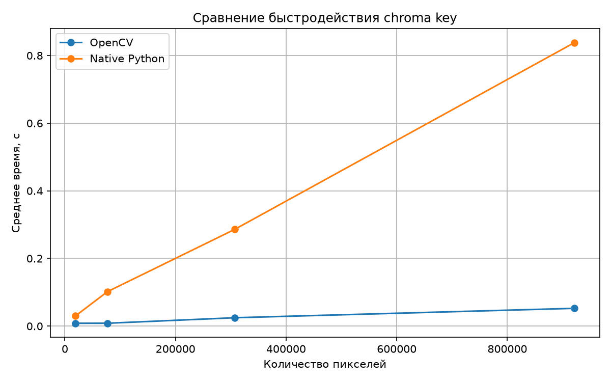
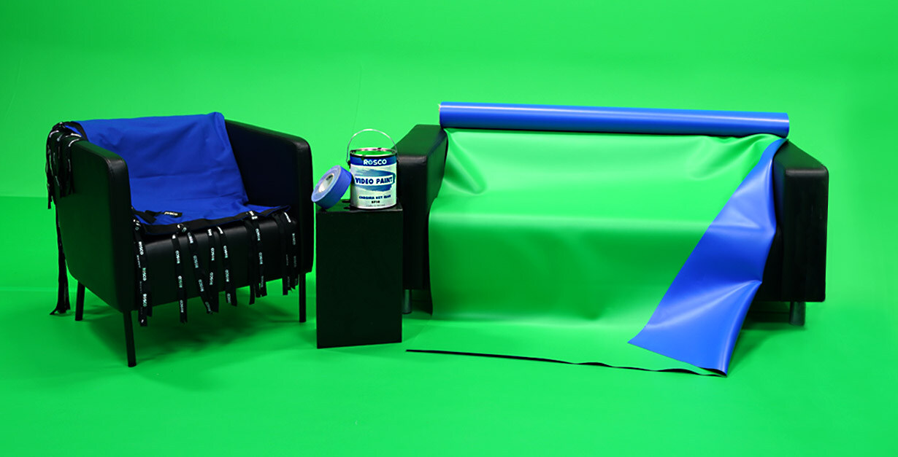
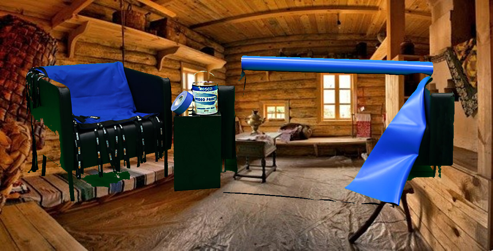

# СКОИ ЛР 1
#### Кулагин Вячеслав 408946 P3409

Практическая работа по обработке изображений. Реализован алгоритм Chroma Key в двух вариантах:

1. с использованием встроенных функций OpenCV;
2. нативно на Python с обработкой пикселей в цикле.

Программа получает два изображения и интервал цвета в HSV. Пиксели первого изображения, попавшие в интервал, заменяются соответствующими пикселями второго изображения.

## 1. Теоретическая база

Chroma Key -- способ выделения однотонного фона на изображении с последующей заменой этого фона другим изображением.

Для каждого пикселя проверяется, принадлежит ли его цвет заданному диапазону. Если принадлежит, берется пиксель из второго изображения. Иначе исходный пиксель сохраняется.

В работе используется цветовое пространство **HSV**:

- H -- Hue -- оттенок / диапазон 0 - 179
- S -- Saturation -- насыщенность / диапазон 0 - 255
- V -- Value -- яркость / диапазон 0 - 255

Интервал (а не какой-то один определенный цвет) используется для того, чтобы перекрыть слабые изменения фона -- более темные или светлые участки, немного другой оттенок

## 2. Описание разработанной системы

### Вариант с OpenCV

1. Загрузить изображение с заменяемым фоном и второе изображение
2. Изменить размер второго изображения до размера первого
3. Перевести первое изображение из BGR в HSV
4. Построить бинарную маску с помощью `cv2.inRange()`
5. На позициях маски заменить пиксели первого изображения пикселями второго
6. Сохранить результат

### Вариант нативный на Python

1. Загрузить оба изображения с помощью Pillow
2. Изменить размер второго изображения до размера первого
3. Последовательно обойти все пиксели первого изображения
4. Для каждого пикселя вручную вычислить HSV
5. Проверить попадание H, S и V в заданные интервалы
6. При попадании взять пиксель из второго изображения, иначе оставить исходный пиксель
7. Сохранить результат

### Архитектура

Используется файл `main.py` как точка входа в приложение. Он позволяет запускать функции обработки изображений по выбранному способу, а также парсит параметры.

В файле `chroma_key.py` описываются функции с вариантами реализации задания: с OpenCV и нативно.

## 3. Результаты работы и тестирования

### Сравнение быстродействия

Были сделаны несколько тестовых запусков с тестовым простым изображением, изменялся его размер (следовательно и сложность).
Результаты представлены в таблице:

| Размер | Кол-во пикселей  |  OpenCV, с | Native Python, с |
|---|---|---:|---:|
| 160×120 | 19200  | 0.008443 | 0.030207 |
| 320×240 | 76800  | 0.008507 | 0.101665 |
| 640×480 | 307200  | 0.024788 | 0.286153 |
| 1280×720 | 921600  | 0.052599 | 0.838286 |

Также был сосзан график зависимостей этих значений для более удобной визуализации:

Можно заметить, что результаты отличаются в 4 - 16 раз (OpenCV значительно быстрее). При этом с большим количеством пикселей нативное решение становится все менее эффективным.
В целом это и не удивительно, ведь нативное решение представляет из себя лишь два цикла, сложность которых прямо пропорциональна количеству элементов.
OpenCV решение оптимизировано, поэтому его сложность кратно ниже, значит и выполняется оно быстрее.

### Пример результата

За основу возьмем два изображения.

Foreground:

Background:

Применив их на алгоритме, получаем:
- OpenCV: 
- Native: 

## 4. Выводы по работе

В работе реализован алгоритм Chroma Key двумя способами: с использованием встроенных средств OpenCV и нативно на Python.

Обе версии выполняют одинаковую последовательность действий: определяют пиксели, попадающие в заданный HSV-интервал, и заменяют их пикселями второго изображения.

Реализация OpenCV выполняется существенно быстрее за счет оптимизированных библиотечных операций.

## 5. Использованные источники

1. OpenCV docs:
   https://docs.opencv.org/4.13.0/d9/df8/tutorial_root.html
2. Pillow Documentation:
   https://pillow.readthedocs.io/
3. Python Documentation — `time.perf_counter()`:
   https://docs.python.org/3/library/time.html#time.perf_counter
